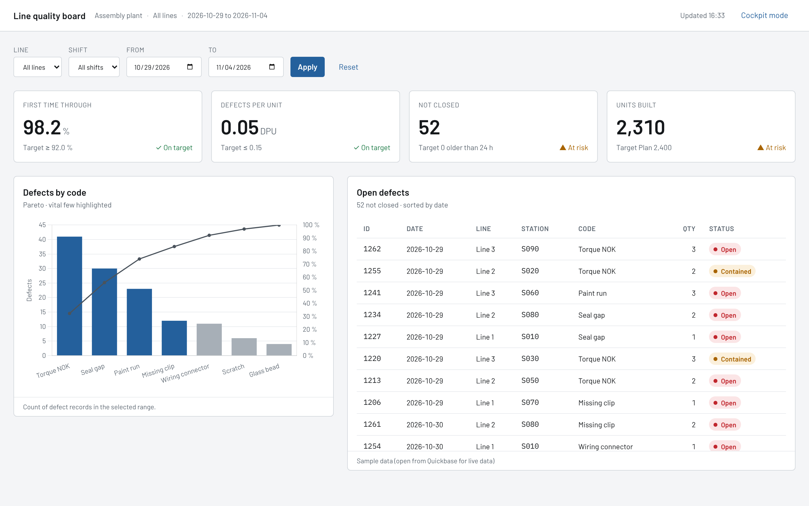

# QuickBase MCP Server

A local [Model Context Protocol](https://modelcontextprotocol.io) server that gives any AI
agent on your machine (Claude Code, Claude Desktop, VS Code / Copilot, Cursor, Codex CLI,
Gemini CLI, Windsurf, LM Studio, Goose …) safe, schema-aware access to Quickbase:

- every **app, table and field ID** (schema map, field search, generated constants),
- **records** (query by label, reports, formulas, change tracking, files, documents),
- **code pages** (pull, diff, review, deploy with build stamps and drift protection),
- **forms, dashboards, roles, code pages and pipelines as QBL** (Solutions, Enterprise),
- **pipelines as YAML** (inspect, lint against the live schema, promote DEV → PROD),
- **built-in skills**: Quickbase engineering playbooks, a modern automotive UI design
  system (so generated pages do not look AI-generated), and automotive domain knowledge
  (8D, PPAP, APQP, SPC, WCM competency matrices, plant KPIs, SDV compliance).

Built on the **2026-07-28** MCP specification with the official TypeScript SDK v2
(`@modelcontextprotocol/server` 2.4), following the
[Build an MCP server](https://modelcontextprotocol.io/docs/2026-07-28/develop/build-server)
guide: `McpServer` + `registerTool` with zod schemas, `serveStdio` with a fresh server per
connection, stderr-only logging. It also serves clients still on the 2025 handshake.



## Quick start

Requires Node.js 20.18 or newer (22.12+ to run the test suite).

```bash
git clone https://github.com/YousifStellantis/QuickBase-MCP-Server.git
cd QuickBase-MCP-Server
npm ci
QB_REALM=yourcompany.quickbase.com QB_USER_TOKEN=<token> QB_APP_ID=<app dbid> node build/index.js doctor
```

`npm ci` installs and builds (`prepare`). Or install it as a command straight from GitHub
(needs git access to the repository) and use `quickbase-mcp` instead of `node …/build/index.js`:

```bash
npm install -g github:YousifStellantis/QuickBase-MCP-Server
```

```bash
quickbase-mcp doctor
```

`doctor` checks Node, config, proxy settings, workspace, skills, the token (XML
`API_GetUserInfo`) and the default app. Then connect your agent (next section) and ask it to
"run test_connection".

**Token**: Quickbase > My preferences > Manage user tokens > New user token, then
*Assign token to apps*. Use a **service account**: tokens die with the account that owns
them. The server never needs (and code pages must never contain) a token in page code.

## Connect your agent

Claude Code:

```bash
claude mcp add quickbase --scope user -e QB_REALM=yourcompany.quickbase.com -e QB_USER_TOKEN="$QB_USER_TOKEN" -e QB_APP_ID=bxxxxxxxx -- node /ABS/PATH/QuickBase-MCP-Server/build/index.js
```

Claude Desktop, Cursor, Windsurf, Gemini CLI, LM Studio (`mcpServers` JSON):

```json
{
  "mcpServers": {
    "quickbase": {
      "command": "node",
      "args": ["/ABS/PATH/QuickBase-MCP-Server/build/index.js"],
      "env": {
        "QB_REALM": "yourcompany.quickbase.com",
        "QB_USER_TOKEN": "…",
        "QB_APP_ID": "bxxxxxxxx",
        "QB_WORKSPACE": "/ABS/PATH/your-code-pages-repo"
      }
    }
  }
}
```

With the global install, use `"command": "quickbase-mcp"` and no `args`. VS Code, Codex CLI,
JetBrains, Goose and Windows paths: see [docs/CLIENTS.md](docs/CLIENTS.md).

## Configuration

| Variable | Default | Purpose |
|---|---|---|
| `QB_REALM` | (required) | `yourcompany.quickbase.com` (a bare `yourcompany` works too) |
| `QB_USER_TOKEN` | (required) | user token; `QUICKBASE_USER_TOKEN` is accepted too |
| `QB_APP_ID` | — | default app dbid |
| `QB_ALLOW_WRITES` | `false` | register write tools (upsert, deploy, schema changes, apply solution) |
| `QB_ALLOW_DESTRUCTIVE` | `false` | also register delete tools (two-step confirmed) |
| `QB_ALLOWED_APPS` | — | comma list of app IDs this server may touch (plus configured apps) |
| `QB_TOOLSETS` | all but `admin` | `apps,records,codepages,pipelines,solutions,schema,admin,skills` or `all` |
| `QB_WORKSPACE` | config dir or cwd | the only folder the server reads/writes (code pages, YAML, QBL, snapshots) |
| `QB_CONFIG` | `./quickbase-mcp.config.json` or `./qb.config.json` | multi-environment config |
| `QB_ENV` | config `defaultEnv` | default environment |
| `QB_SKILLS_DIR` | — | extra skills folder (your own brand rules etc.), overrides built-ins by name |
| `QB_QBL_VERSION` | — | sent as `QBL-Version` on Solution API calls when set |
| `QB_RATE_LIMIT` | `90` | client-side requests per 10 s per token (Quickbase allows ~100) |
| `QB_TIMEOUT_MS` | `30000` | per request |
| `QB_MAX_OUTPUT_CHARS` | `60000` | tool output budget before truncation |
| `QB_LOG_LEVEL` | `info` | stderr log level |
| `HTTPS_PROXY`, `NO_PROXY`, `NODE_EXTRA_CA_CERTS` | — | corporate proxy and TLS inspection |

### Multiple environments (DEV / TEST / PROD)

Copy [quickbase-mcp.config.example.json](quickbase-mcp.config.example.json) to
`quickbase-mcp.config.json` (gitignored) and put tokens in a `.env` beside it
([.env.example](.env.example)). The format is compatible with **qb-deploy**'s
`qb.config.json` (`defaultEnv`, `environments`, `targets` with `pageIds` per environment),
uses the same `.qb-deploy-state.json` drift state and build stamp, and the same
`__QB_FIELD:table.field__` placeholders with `config/fields.<env>.json`. The two tools can
be used side by side on one repo. Environments marked `"protected": true` need
`confirm: "<env name>"` on every write.

## Safety model

- **Read-only by default.** Write tools are not even registered until `QB_ALLOW_WRITES=true`;
  delete tools need `QB_ALLOW_DESTRUCTIVE=true` as well.
- **Two-step deletes**: the first call returns the record count / field usage and an exact
  confirm phrase; only a second call with that phrase deletes.
- **Protected environments** require the environment name as confirmation.
- **App allowlist** (`QB_ALLOWED_APPS`) blocks any table or app outside the list.
- **Code page deploys** are blocked when the page contains a user token, refuse to overwrite a
  page edited in the browser (drift) unless `force`, and support `dryRun`.
- **Workspace jail**: file access is limited to `QB_WORKSPACE` (symlink escapes rejected).
  Generated caches (schema snapshots, large pulled pages) go to `.quickbase/` inside it; add
  `.quickbase/` and `.qb-deploy-state.json` to that repo's `.gitignore`.
- Tokens are redacted from errors and logs; stdout carries only JSON-RPC.
- Client-side rate limiting, `Retry-After` handling, retries only for idempotent calls.
- Tool annotations (`readOnlyHint`, `destructiveHint` …) let clients ask before risky calls.

## Tools

Default read-only set: 33 tools. With writes, destructive, admin and a configured pipeline webhook: 52.

| Toolset | Tools |
|---|---|
| (always) | `test_connection`, `list_apps` |
| `apps` | `get_app`, `get_table`, `get_fields`, `get_field_usage`, `list_relationships`, `get_reports`, `list_app_roles`, `list_app_events`, **`get_schema_map`**, `find_fields`, **`generate_field_constants`** |
| `records` | `query_records`, `run_report`, `run_formula`, `records_modified_since`, `download_file`, `generate_document` · write: `upsert_records` · destructive: `delete_records` |
| `codepages` | `get_code_page`, `diff_code_page`, **`analyze_code_page`**, `discover_code_pages` · write: **`deploy_code_page`** |
| `pipelines` | `list_pipeline_files`, **`inspect_pipeline`**, **`remap_pipeline`**, `save_pipeline` · write: `trigger_pipeline` (allowlisted webhooks only) |
| `solutions` | `export_solution`, `get_solution_info`, `inspect_qbl`, `preview_solution_changes` · write: `apply_solution` |
| `schema` | write: `create_table`, `update_table`, `create_field`, `update_field`, `create_relationship`, `update_relationship`, `update_app` · destructive: `delete_fields`, `delete_relationship`, `delete_table` |
| `admin` (opt-in) | `get_users`, `get_trustees`, `get_audit_log`, `get_platform_analytics` |
| `skills` | `list_skills`, `load_skill` |

**Resources**: `quickbase://capabilities` (what the APIs can and cannot do),
`quickbase://config` (redacted), `quickbase://apps/{appId}/schema`,
`quickbase://tables/{tableId}/fields`, and every skill file as `skill://quickbase/...`.

**Prompts** (slash commands): `build-code-page`, `review-code-page`, `explain-app`,
`promote-pipeline`, `design-app`, plus one prompt per skill.

## Skills

| Skill | Use it for |
|---|---|
| `automotive-ui-design-system` | any page or chart: tokens (light + dark "cockpit" mode), page template, Chart.js theme (Pareto, control charts, radar), anti-patterns that look AI-generated, review checklist |
| `quickbase-code-pages` | temp-token auth, browser client, pagination, states, deploy workflow |
| `quickbase-schema-design` | tables, keys, relationships, formulas, roles, environments |
| `quickbase-query-language` | `{fid.OP.'value'}` syntax, query/upsert/delete bodies, value formats |
| `quickbase-pipelines-yaml` | export format, Jinja, linting, DEV → PROD promotion, import rules |
| `quickbase-solutions-qbl` | forms, dashboards, code pages as QBL; preview/apply between environments |
| `automotive-quality-core-tools` | 8D, 5-Why, QRQC, PFMEA (AP), control plans, APQP, PPAP, SPC, MSA, IATF/Stellantis CSR context, app models |
| `plant-competency-matrix` | WCM domains, 0–5/ILUO levels, gaps, 3×3 coverage, radar rules, modern skills catalog |
| `plant-kpi-dictionary` | SQDCP KPIs with definitions, decimals, Quickbase formulas, tier boards |
| `automotive-software-compliance` | ISO 26262, SOTIF, ISO/SAE 21434, UNECE R155/R156, ASPICE 4.0, traceability/TARA/OTA app models |

How agents get them (all from the same files in [skills/](skills/)):

1. **MCP Skills extension** (`io.modelcontextprotocol/skills`, SEP-2640): `skills/list`,
   `skills/get`, verified `skill://` reads, for clients that implement it.
2. **Resources**: the same `skill://` URIs in `resources/list`.
3. **Prompts**: one per skill.
4. **Tools**: `list_skills` / `load_skill` for every other client.
5. **Native folders**: `node build/index.js install-skills --dir .claude/skills` copies them into
   Claude Code's skills folder (or any agent that reads `SKILL.md` folders).

Add your own (for example official brand colors, plant standards) with `QB_SKILLS_DIR`.

## Typical workflows

- *"Build an andon-style quality board for Line 2 from the Defects table."* The agent loads
  the design + code page skills, reads the schema map, generates constants, writes the page in
  the workspace, runs `analyze_code_page`, and deploys only when you say so (dry run first).
- *"Review KPI.html."* `analyze_code_page` checks every DBID/FID against the live schema, finds
  embedded tokens, unpinned CDNs, unescaped HTML; the design checklist covers the rest.
- *"Move the escalation pipeline to PROD."* `inspect_pipeline` → `remap_pipeline` with autoMap
  (tables by name, fields by label, account slug) → lint against PROD → import steps.
- *"Explain this app."* Schema map → Mermaid ER diagram, automations, roles, risks.
- *"Design an 8D tracker."* Domain skill → tables, fields, formulas, reports and pipelines as
  a spec; created only after approval (writes enabled).

## What Quickbase allows (summary)

| | Read | Write | How |
|---|---|---|---|
| Apps, tables, fields, relationships, records, reports (run), formulas | ✅ | ✅ | JSON API |
| Code pages | ✅ | ✅ create/replace | XML API (no listing API) |
| Forms, dashboards, roles, pages as schema | ⚠️ | ⚠️ | Solutions/QBL, Enterprise only |
| Pipelines | ⚠️ YAML export | ⚠️ YAML import | UI (no REST API); some channels via QBL |
| Report/form layout editing, page deletion, pipeline listing | ❌ | ❌ | UI only |

Full matrix, limits and sources: [docs/CAPABILITIES.md](docs/CAPABILITIES.md). Automotive /
Stellantis research behind the skills: [docs/AUTOMOTIVE-RESEARCH.md](docs/AUTOMOTIVE-RESEARCH.md).

## MCP 2026-07-28 notes

- Stateless protocol: no `initialize` handshake for modern clients; `server/discover`
  advertises capabilities, including the skills extension. `serveStdio` keeps 2025-era
  clients working on the same binary.
- `tools/list` is deterministic and carries cache hints (`ttlMs`, `cacheScope`).
- Logging goes to stderr only (the protocol's logging feature is deprecated in this revision).
- Check both eras with the Inspector: `npm run inspect:modern`, `npm run inspect:legacy`,
  `npm run inspect:skills` (SEP-2640 digest verification).

## Development

```bash
npm run build        # TypeScript -> build/
npm test             # build + unit tests + end-to-end tests (fake Quickbase, both protocol eras)
npm run typecheck
```

CI (`.github/workflows/ci.yml`) runs the tests on Ubuntu (Node 22, 24) and Windows (Node 22),
then the MCP Inspector in both protocol eras with SEP-2640 skill verification.

Layout: `src/quickbase` (JSON/XML clients, schema), `src/codepages`, `src/pipelines`,
`src/solutions`, `src/tools`, `skills/`, `docs/`, `test/`.

## Repository

This is the canonical home of the server: https://github.com/YousifStellantis/QuickBase-MCP-Server.
It started in the `quickbase-mcp-server/` folder of the RADARCHARTS repository; the history
was carried over with `git subtree split`. The code pages it manages (KPI, radar charts) stay
in RADARCHARTS: point `QB_WORKSPACE` at that checkout.

## Troubleshooting

- **401**: wrong token or realm. **403**: token not assigned to the app, or role lacks access.
- **Requests hang / time out** on a corporate network: set `HTTPS_PROXY` (and `NO_PROXY`);
  for TLS inspection set `NODE_EXTRA_CA_CERTS` to the corporate root CA file.
- **Tools missing**: writes are off, or a toolset is disabled (`test_connection` reports both).
- **Claude Desktop shows nothing**: fully quit and restart; check `mcp-server-quickbase.log`.
- **Windows**: use `node` as the command and an absolute `C:\\...\\build\\index.js` path.
